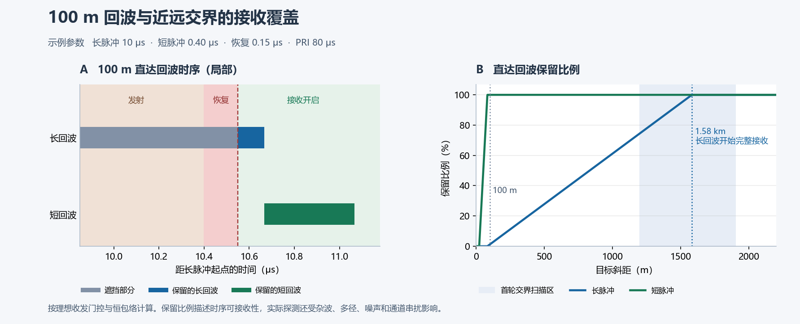

# 赛题 2 文献与创新线索

首轮检索于 2026-11-09。以下区分文献中已有的机制、赛题约束下的推论，以及需要通过实验检验的候选方案。

## 题目固定的条件

题目规定 Ku 波段一维有源相控阵脉冲雷达，方位机械扫描、俯仰电子扫描。需要验证 **100 m 低空目标可采集且可检测**、**远距探测性能不劣于传统固定长脉冲**，以及**近远交界和全距离段的覆盖**。题目开放波形、时序和信号处理方案，未指定脉宽、PRI、远距验收端点、硬件收发恢复时间或检测门槛。创新与方案设计占 25 分，另有交界及全距离验证要求。做仿真时应把题目未给定的参数和验收口径显式列出。[赛题原文](../赛题2-算法-原文.md)

## 已核实的先例

| 路线 | 一手资料中的结果 | 对赛题可用的部分与待验证边界 |
| --- | --- | --- |
| 长短脉冲交替 | Torres、Curtis 与 Schvartzman（2017）在引言比较了脉间交替和同次发射的频分补盲。交替有驻留时间代价。Bharadwaj 与 Chandrasekar（2012）指出，逐发长短交替、分波形处理时，每路有效脉冲重复间隔加倍。 | 适合做参赛对照。在原驻留时间内替换一部分长脉冲时，需量化远距积累损失和测速范围变化。 [Torres 等，引言](https://repository.library.noaa.gov/view/noaa/59970/noaa_59970_DS1.pdf) · [Bharadwaj 与 Chandrasekar](https://journals.ametsoc.org/view/journals/atot/29/1/jtech-d-11-00030_1.xml) |
| 时频复合波形 | Cheong 等（2013）在 X 波段 PX-1000 实机验证时频复用补盲。NOAA/NSSL 的 ATD 报告也记录了紧跟相位调制长脉冲发送短脉冲，再按频率分离两路回波。Torres 等指出长短脉冲灵敏度不同，合并时可能出现伪影。 | “同一发射周期使用长脉冲和短补盲脉冲”已有实机先例。两路回波分离、带宽占用、动态范围和交界检测是本题需单独建模的部分。 [Cheong 等，§ II-A、§ IV 及 Fig. 9](https://arrc.ou.edu/~boonleng/pdf/cheong%2B%2B13_px1000.pdf) · [NOAA/NSSL ATD 报告，§ 2.1](https://www.nssl.noaa.gov/publications/par_reports/Preliminary%20Report%20on%20Polarimetric%20Calibration%20for%20the%20Advanced%20Technology%20Demonstrator.pdf) · [Torres 等，引言](https://repository.library.noaa.gov/view/noaa/59970/noaa_59970_DS1.pdf#page=2) |
| 低空三脉冲与距离拼接 | CN120446933A 申请公开文本给出宽、窄、中三脉冲，分路下变频和脉压，按距离拼接后做运动目标检测。示例用 1 μs 窄脉冲，最近目标在 1000 m，仿真只考虑高斯白噪声。 | 需要把三脉冲、按距离拼接及 MTD 视为已有组合。该示例的 1000 m 与白噪声结果不能外推到 100 m 地杂波和多径场景。 [CN120446933A，公开说明书 §[0111]–[0118] 和权利要求](https://eureka.patsnap.com/patent/CN120446933A) |
| 截断长回波处理 | Aquino、Cheong 与 Palmer（2021）提出渐进式脉冲压缩，用发射期间被遮挡后剩余的回波尾部匹配压缩并校正，在 X 波段 PX-1000 上验证。Alaee 等（2023）进一步研究部分相关下的发射波形和接收滤波器联合设计。 | 可做不增加发射脉冲的补盲基线。需核查 100 m 的可用尾部、截断后的旁瓣和检测性能。后端只能利用接收恢复后采到的样本。 [Aquino 等原文及实机结果](https://repository.library.noaa.gov/view/noaa/47646) · [Alaee 等作者稿](https://orbilu.uni.lu/handle/10993/57811) |
| 参差 PRI | Cho（2005）用多 PRI 及配套处理缓解气象雷达的距离折叠和速度模糊，以仿真及实测数据验证。 | 固定脉宽且每次都遮住 100 m 回波时，仅改变脉冲起点间隔无法打开每发脉冲后的接收窗口。可把参差 PRI 用于处理跨周期回波遮挡、距离折叠或速度模糊，并检查非均匀慢时间处理的代价。 [MIT Lincoln Laboratory，Cho 论文](https://www.ll.mit.edu/r-d/publications/multi-pri-signal-processing-terminal-doppler-weather-radar-part-ii-range-velocity) |
| 地杂波、多径与 RCS | Galati 等使用商用 X 波段雷达在郊区标定并测量地面散射与多径。Ezuma 等在紧缩场测量三种小无人机 15 GHz、25 GHz 的 RCS，实测显示方向和频率差异。 | 基带模型分别加入地物回波和目标的相干反射路径。后者会随几何和相位改变而相长或相消。用 15 GHz 测量启发 RCS 与姿态的敏感性扫描，具体数值须对应目标与测量条件。 [Galati 等现场实验](https://www.mdpi.com/1424-8220/20/2/463) · [Ezuma 等测量论文](https://arxiv.org/abs/1911.05926) |

## 候选创新与淘汰实验

以下是假设。每项用相同波形或等价资源下的对照实验验证后，再确定是否写成参赛贡献。

| 优先级 | 可以实现的差异 | 最小实验与淘汰条件 |
| --- | --- | --- |
| 1. 根据可用回波和背景估计融合交界检测 | 对长短通道分别按收发门控计算匹配模板的可用能量，估计局部杂波和噪声，再融合已对齐到同一距离－速度网格的检测统计量。远距仍用长脉冲。融合门限用无目标样本标定，并把两路统计相关性纳入验证。 | 固定相同波形和数据，比较按距离硬切换、固定权重和候选方法。在同一**最终虚警率**下，密扫交界区，报告最低检测概率、两侧曲线、距离误差和重复点迹。若优势只出现在单一地面反射相位或调低阈值后，淘汰。 |
| 2. 按收发恢复时间联合设计长脉冲尾部与接收模板 | 给定原长脉冲能量、峰值功率、带宽和驻留时间，把 100 m 门控后可见模板的旁瓣和弱目标可检测性纳入波形／滤波器选择。已有渐进式脉冲压缩和联合设计，差异需落实到本题的门控与低空检测指标。 | 先扫恢复时间和分数时延，核对 100 m 实际保留的能量。以原 LFM 的渐进式脉冲压缩为对照，对比 100 m 检测概率与远距积累后表现。若多数允许的恢复时间下可用样本为零，或优化牺牲了远距表现，淘汰。 |
| 3. 在固定远距驻留下调度短脉冲 | 固定长脉冲时刻，按长脉冲远距接收窗、短脉冲近距接收窗、恢复时间和占空比生成可用时隙。若候选可行，再优化插入位置来减少距离－速度平面上的遮挡和跨周期干扰。 | 对照固定时隙插入和长短交替。在相同峰值功率、驻留、硬件带宽和允许占空比下，比较近远检测和多普勒模糊。若可用时隙为空、远距接收受损，或等资源条件下固定时隙已达同样表现，淘汰。 |

## 第一轮结束后如何收敛

1. 用一张覆盖图同时标出完全遮挡、截断和完整接收。100 m 的往返时延约为 0.667 μs。以短脉冲发射起点计，完整接收直达回波要求该脉冲之后接收机在此时延前恢复，且后续发射不再截断回波。对孤立矩形包络长脉冲，若其脉宽大于往返时延、接收机在发射结束后 `t_rec` 恢复且下一发不截断，可见尾部长约为 `max(0, 0.667 μs − t_rec)`。这是时序推导，仍需检测实验。
2. 先明确两个固定脉宽基线和一个已有补盲对照。远距对比固定波束驻留时间、峰值功率和最终虚警率，另记带宽、占空比、每驻留发射能量和长脉冲数。禁止通过减少固定长脉冲基线的积累次数来获得表面上的优势。
3. 先跑候选 1，做少量不同杂波强度、地面反射相位与 RCS 的交界实验。若未通过时序检查，优先解决发射方案可行性。若融合只在个别场景占优，重新定义目标或转向候选 2。

## 下一轮检索队列

- 查找在距离交界应用基于局部背景估计的检测融合。可用 `fill pulse transition detection fusion CFAR`、`range eclipsing partial echo CFAR`、`多脉宽 距离拼接 自适应融合 雷达` 检索，沿参考文献和后续引用追踪。重点识别与候选 1 机制相同的研究。
- 查找 Ku 波段低掠角、地杂波与无人机检测的现场实验。优先提取地表类型、波束仰角、目标高度、径向速度、RCS、探测概率和虚警率定义。
- 继续阅读 CN120446933A 引用文献及渐进式脉冲压缩的相关公开文本。补充相近方案的时序、输入输出和约束，区分论文实测、仿真和专利实施例。

后续每条文献沿用四个字段记录。**来源与位置**（链接及章节或图号）、**作者验证了什么**、**适用条件**、**对应的对照实验或候选假设**。

## 第二轮专项检索与交界检测

**距离维长短脉冲加权融合已有直接公开先例。** 本轮最接近的是 CN121477127A。能继续检验的工程差异是，用实际收发门控得到的可见回波模板能量和局部背景估计构造检测统计量，并验证它在相同虚警率下能否缓解低空交界区的漏检。

| 一手来源 | 已公开的机制 | 对候选方案的重合程度 |
| --- | --- | --- |
| CN121477127A，公开说明书 [0030]、[0054]–[0060]、权利要求 9 | 长短脉冲分路匹配滤波和多普勒处理，短脉冲填补长脉冲遮挡，再把长距检测结果与近距结果沿距离维加权融合。说明书也提到滤波系数可随杂波类型调整。 | **直接覆盖长短两路加权拼接。** 所读融合段落没有给出按可见模板能量和局部杂波联合定权的规则，也没有给出本题场景的等虚警率结果。按段落核实公开内容，不把其概述的效果当成实测。 [申请公开说明书与权利要求](https://eureka.patsnap.com/patent/CN121477127A) |
| CN120446933A，公开说明书 [0087]–[0099] | 实施例按距离在窄、中、宽脉冲之间切换，交界段换到中脉冲，中远段利用宽脉冲的部分回波，拼接后做 MTD。 | **直接覆盖分段切换与用中脉冲缓解交界缺口。** 可将按距离切换作为基线，同一发射波形下比较检测级融合。 [申请公开说明书](https://eureka.patsnap.com/patent/CN120446933A) |
| Cheong、Kurdzo、Zhang 与 Palmer，2013 年会议论文 | PX-1000 长短脉冲过渡处信噪比突变，导致交叉极化相关系数不连续。作者比较多滞后估计和常规估计，报告中低信噪比下多滞后估计改善该气象量。Kurdzo 等 2014 年的实测则在盲区内外分别采用短、长脉冲匹配滤波。 | **直接确认交界现象，处理目标不同。** 气象相关系数的连续性不能替代低空点目标的检测概率和虚警率。 [会议作者稿](https://ams.confex.com/ams/36Radar/webprogram/Manuscript/Paper228464/px1000.pdf) · [Kurdzo 等作者稿](https://arrc.ou.edu/~boonleng/pdf/kurdzo%2B%2B14_waveform.pdf) |
| Shokooh 等，2018 年自适应脉压研究；US8259003B2 | 前者根据遮挡修改匹配滤波后处理所用的导向向量，并使用协方差建模。后者按强弱回波重叠程度，对回波或模板加权，再做脉压以抑制干扰。 | **与按遮挡情况建模和自适应加权相关，处理位于脉压前或脉压后滤波环节。** 长短两路在同一目标单元的最终检测融合仍需独立比较。 [Shokooh 等，§ 3](https://ietresearch.onlinelibrary.wiley.com/doi/10.1049/iet-rsn.2018.5254) · [US8259003B2，Fig. 2A–2C 与说明书](https://patents.google.com/patent/US8259003B2/en) |
| 分布式 MIMO 融合检测与波形分离 | 一项原始研究用通道选择与 GLRT／Wald 处理各通道信噪比不均衡，另一项用 GLRT 对目标回波和波形分离残差建模。 | **说明依据信噪比差异选择通道、用 GLRT 处理多通道干扰均有先例。** 其通道来自分布式雷达，复现前需明确本题中两路目标幅度和相位是否可校准，以及频分串扰和共同杂波的相关性。 [融合检测论文摘要](https://www.sciencedirect.com/science/article/abs/pii/S0165168423003304) · [波形分离论文作者机构条目](https://researchwith.stevens.edu/en/publications/target-detection-with-imperfect-waveform-separation-in-distribute/) |

若发射时序采用“长脉冲 → 等待远距回波 → 短脉冲 → 接收近距回波”，日本专利公开文本在背景技术中已用图 6 描述这个顺序。可以据此选传统时序对照，再计算本题给定驻留下的远距窗、收发恢复和占空比约束。[JP2834046B2，§[0003]、图 6](https://patents.google.com/patent/JP2834046B2/en)

### 最小对照实验

1. 保持发射波形和仿真回波相同。长短两路各自脉压和慢时间处理后，校准到同一距离－径向速度网格。时序门控给出每个距离下两路模板的可见能量，完全遮挡的通道不参加融合。
2. 比较硬切换、固定权重、仅按可见能量加权、仅按局部背景加权，以及两者共同定权。可先用归一化功率进行非相干融合，用含杂波但无目标的独立样本标定各方法最终门限。若背景相关明显，记录相关性并检验它是否改变实际虚警率。权重和阈值使用与最终评测分开的数据。
3. 同时报交界区各距离的检测概率、最低检测概率和实测虚警率，并扫描多径相位、地杂波强度、杂波边缘以及两路相关性。如果联合定权在等虚警率下与单因素方法表现相当，保留简单方法。如果时序或灵敏度没有形成可用的重叠距离，先调整波形和时序。

本轮检索了中英文多脉宽距离拼接、补盲脉冲过渡、遮挡脉压、局部杂波、GLRT／CFAR 及相关公开申请。已读材料里尚未核实到同时明确披露“按实际门控模板能量和局部背景定权、同一距离－速度单元融合、用低空杂波和相同虚警率验证”的同构方法。这个结论只覆盖上述检索和已读文本，不能作为新颖性证明。

## 首轮时序可行性计算

用 **10 μs 长脉冲紧接 0.40 μs 短脉冲**作为已知时频复用路线的示例。假定恢复时间 0.15 μs、PRI 80 μs、收发门控为理想开关、两路可分离。参数为可更换的仿真假设。接收窗为 [10.55, 80) μs。令 Δ 为斜距 R 对应的往返时延 2R/c，分别把长回波区间 [Δ, Δ + 10) 和短回波区间 [10 + Δ, 10.4 + Δ) 与接收窗取交集。恒包络下，交集时长除以各自脉宽即为保留能量比例。这里只计算本周期发出的直达回波在本周期内可接收的部分，跨周期回波和频分串扰留给基带仿真。

| 检查点 | 理想门控结果 | 对仿真的影响 |
| --- | --- | --- |
| 100 m 直达回波 | Δ ≈ 0.667 μs。短回波完整接收，接收开启比短回波前沿提前约 0.117 μs。长回波只剩约 0.117 μs，约为自身完整能量的 1.17%。 | 在 0.40 μs 短脉宽下，完整接收要求发完短脉冲后的总恢复和保护时间不超过约 0.267 μs。后续用 100 m 的检测概率验收。 |
| 交界扫描 | 长回波约从 1.58 km 开始完整接收。相同峰值功率、恒包络下，长回波的可见时长在约 142 m 就达到短脉宽，两路门控保留的绝对信号能量相等。 | 分开扫描 100–250 m 和 1.2–1.9 km。前者覆盖示例的能量交叉，后者覆盖长脉冲完整接收边界。实际检测交接点取决于波形、接收分离、杂波、多径和处理增益，从各自的检测概率曲线确定。 |
| 远距与发射预算 | 长回波在约 1.58–10.49 km 内完整落入本周期接收窗。和同 PRI、同长脉宽的纯长脉冲比较，长脉冲发射次数相同，发射占空比从 12.5% 增至 13.0%。 | 检查发射机余量和长短两路的串扰，再以同驻留、同峰值功率和同实测虚警率比较远距检测。距离上界是时序边界，实际探测端点由链路预算和检测实验确定。 |
